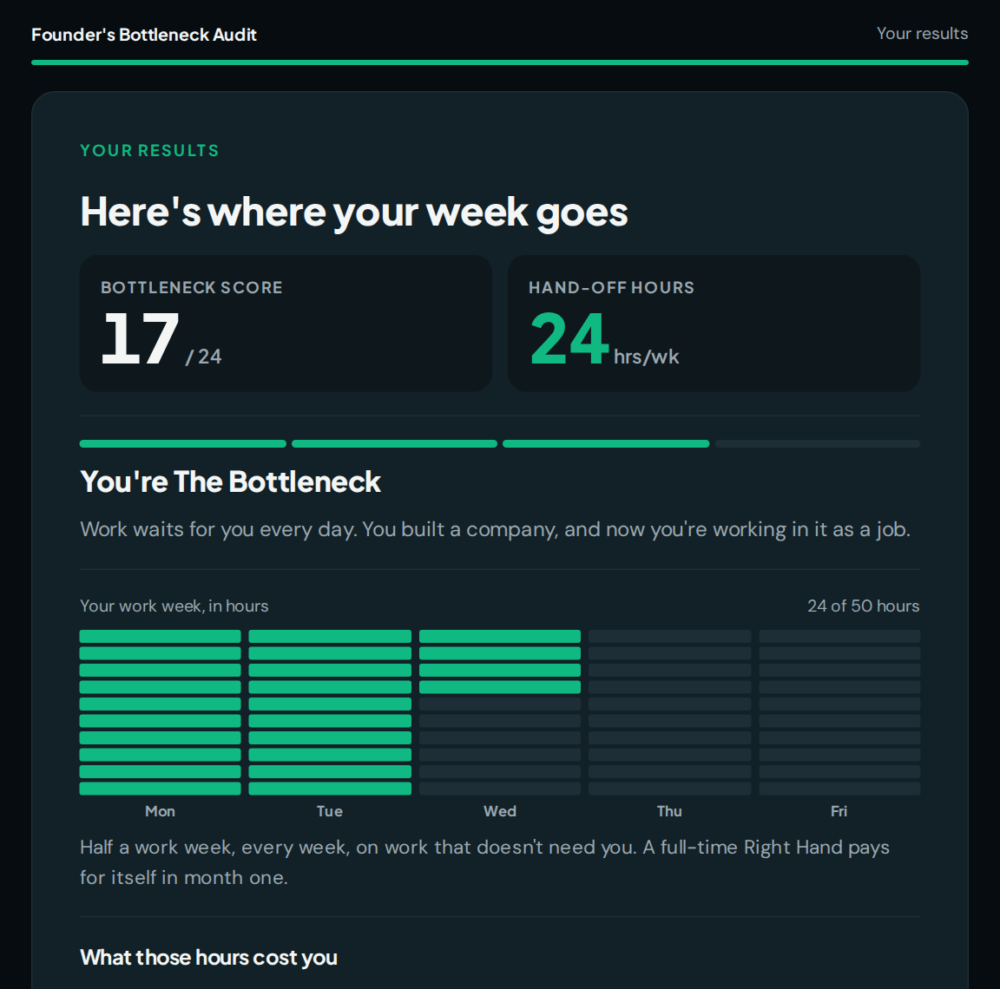
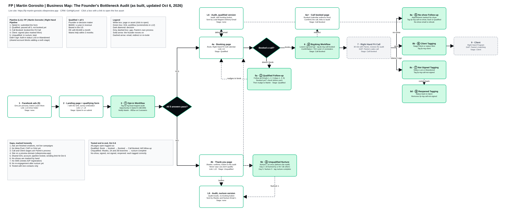

# The Founder's Bottleneck Audit: a lead magnet funnel for Pareto Talent

A complete lead generation funnel for [Pareto Talent](https://paretotalent.com), a company that places full-time executive assistants ("Right Hands") with US founders. I built it end to end in October 2026 as the capstone project of Pareto Talent's bootcamp: research, offer, an interactive lead magnet, landing and booking pages, a GoHighLevel pipeline with eight workflows and twelve emails, and five Facebook ads.

## The problem

Pareto's best clients are founders doing $500K+ a year who are buried in work that doesn't need them. Pareto's analysis of 1,500+ founder calls shows that 80% are drowning in admin and 60% have already been burned by a VA. These founders don't respond to "hire an assistant". They respond when someone shows them exactly where their week goes.

## What I built

**The lead magnet:** *The Founder's Bottleneck Audit: Find the 10 Hours a Week You Should Never Touch Again.* It's an interactive, stepped web audit that takes under 10 minutes. The founder rates 8 business systems on who runs them and how many hours they take. The audit then returns a Bottleneck Score (0 to 24), the "Hand-off Hours" they could delegate, what those hours cost, and a 30-day hand-off plan. It is written in vanilla HTML/CSS/JS, has no dependencies, and is pasted into GoHighLevel as a single embed. There is also a printable PDF version.

**The funnel:**

1. **Ads:** five Facebook ads, one per founder persona, each built around a different reason the founder needs help.
2. **Landing page:** hero, what's inside, who it's for, proof with real Pareto numbers, and a CTA with the form.
3. **Qualifying form:** a GoHighLevel survey. Founders who meet all five criteria (decision maker, $500K+ revenue, US based, budget fits, wants help within 3 months) go to the booking page. Everyone else goes to a thank-you page that still delivers the audit. Nobody is ever told they "don't qualify".
4. **Automation:** a 5-stage pipeline and 8 workflows, covering opt-in routing, a 3-email qualified follow-up, a 3-email nurture that splits on whether the founder was burned by a VA before, booking confirmation and reminders, no-show recovery, and outcome tagging (client, not signed, reopened).
5. **Testing:** the full chain was tested end to end with test contacts for every branch.

## What's in this repo

| Folder | What it holds |
|---|---|
| [`audit-app/`](audit-app) | The interactive audit: `index.html` runs on its own, and `ghl-embed.html` is the version pasted into GoHighLevel. Also the printable PDF and the post-booking page embed. Add `?fit=no` to the URL to see the version without the booking button. |
| [`emails/`](emails) | `generate_emails.py` turns the email copy in `docs/automation/emails.md` into 12 branded, paste-ready HTML emails, with links as GoHighLevel Custom Values. The output is in `emails/html/`. |
| [`ads/`](ads) | The five final ads, the raw AI images, and `render_ads.py`, which overlays the hooks, wordmark and CTA with a headless browser. |
| [`docs/strategy/`](docs/strategy) | Market research and personas, offer and qualification decisions, the business map, the project plan, and a reusable SOP for the next launch. |
| [`docs/funnel/`](docs/funnel) | Audit content, landing page copy, qualifying form logic, the booking and thank-you pages, and the AI prompts used to build the pages. |
| [`docs/automation/`](docs/automation) | Pipeline and workflow design, step-by-step build notes, all email copy, and the end-to-end test script. |
| [`docs/ads/`](docs/ads) | Ad copy, hooks, image prompts and the scoring of each ad. |
| [`assets/`](assets) | The business map (PNG and editable `.drawio`), audit images, and screenshots of the pipeline and workflows in GoHighLevel. |

## Tools

GoHighLevel (surveys, calendar, pipeline, workflows, email), GoHighLevel AI Studio (pages), Claude (research, copy and code), ChatGPT and OpenArt (ad imagery), Notion (project board), Python with pandoc and Playwright (email and ad build scripts).

## What I'd do next

- Put the pages on a real domain and add the Meta Pixel and Conversions API before spending on ads.
- Add a re-engagement campaign for founders who finished the nurture, and re-qualify them in six months.
- A/B test the ad hooks, and compare the audit's completion rate against the opt-in rate.

## Notes

- The GoHighLevel names in the screenshots (`FP | Martin Gorosito | ...`) and the `fp-mg-` tag prefix come from building in an account shared with other bootcamp participants.
- The live pages ([landing](https://fp-martin-gorosito.vibepreview.app), [audit](https://fp-martin-gorosito.vibepreview.app/audit)) and the [Notion project board](https://fp-martingorosito.notion.site/bb3d363f46284a78a47fb5dd68954b7d?v=8d0d09f573c64ae6a9a68cb83fde58d4) are on temporary hosting and may stop working. Everything needed to rebuild them is in this repo.
- "Day N" references in the docs point to the bootcamp session an idea or number came from. Pareto Talent's name, pricing, guarantees and testimonials come from their public website, checked October 2026. This is not an official Pareto Talent repository.
